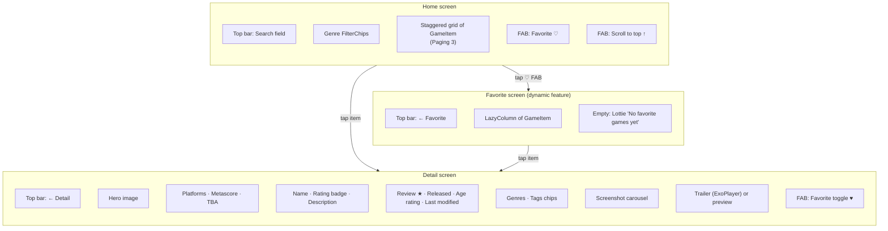

# 1. Project Overview

## Purpose

**STG** is a video-game catalogue app built for the Dicoding **Android Developer Expert** capstone. It shows the expert-level skills that course grades:

- **Clean Architecture** with separate data, domain, and presentation layers
- **Modularization**, including a **Dynamic Feature Module** delivered with Play Feature Delivery
- **Reactive programming** with Kotlin Coroutines and Flow
- **Dependency injection** with Koin
- **Security**: SQLCipher database encryption, certificate pinning, and R8 obfuscation
- **Performance**: Paging 3, LeakCanary in debug builds, and resource shrinking
- **CI**: CircleCI

All game data comes from the public **RAWG Video Games Database API** (`https://api.rawg.io/api/`).

## Features

| Feature | Where | Description |
|---|---|---|
| Infinite game list | Home | 2-column staggered grid that loads 20 games per page from `/games` with Paging 3 |
| Search | Home (top bar) | Text field. Typing is debounced by 500 ms, then the list is re-queried with `search=` |
| Genre filter | Home | Horizontal chips loaded from `/genres`. Selecting a chip re-queries with `genres=<id>` |
| Pull-to-refresh | Home | Custom indicator ("Pull to Refresh" text, then a line-scale loader). Clears search and filter |
| Scroll-to-top | Home | A FAB appears after item index 20 while the list isn't scrolling |
| Loading / empty / error states | Home | Shimmer `LoadingCard`s, a Lottie "not found" animation, a Lottie "no connection" animation, and an offline Toast |
| Game detail | Detail | Hero image, platforms (icons, max 3 + "+N"), Metacritic score badge (color-coded), TBA badge, name, rating badge, description, star rating, release date, ESRB age rating, last modified, genres, tags |
| Screenshot carousel | Detail | Auto-scrolling infinite `HorizontalPager` that advances every 3 s, with a scale effect |
| Trailer player | Detail | Media3 ExoPlayer with custom controls (play/pause, seek bar, time). Controls auto-hide after 3 s. Videos auto-advance and loop. When offline, a static preview image shows instead |
| Favorite toggle | Detail (FAB) | Saves the game to the encrypted local DB, or removes it. The FAB hides while the page scrolls |
| Offline detail | Detail | If the network call fails with an `IOException`, the app falls back to the locally stored game (only favorited games are stored) |
| Favorites list | Favorite (dynamic module) | A list of saved games, read reactively from Room. Tapping an item opens its detail page |
| Localization | All | Default (English), `values-en`, and `values-in` (Indonesian) |
| Network awareness | All ViewModels | `ConnectivityObserver` exposes `Available / Unavailable / Losing / Lost` as a `StateFlow` |

## Screens at a glance

## Tech stack

| Concern | Library | Version (from `gradle/libs.versions.toml`) |
|---|---|---|
| Build | Android Gradle Plugin | 9.4.1 |
| Language | Kotlin (+ Compose and Serialization plugins) | 2.3.20 |
| Annotation processing | KSP | 2.3.6 |
| UI | Compose BOM / Material 3 / Material Icons Extended | 2026.03.00 |
| Navigation | Navigation Compose (type-safe `@Serializable` routes) | 2.9.7 |
| DI | Koin Android + Koin Compose | 4.2.0 |
| Networking | Retrofit + Gson converter | 3.0.0 |
| HTTP client | OkHttp + logging interceptor | 5.3.2 |
| Local DB | Room (runtime, ktx, paging) | 2.8.4 |
| DB encryption | SQLCipher for Android (`net.zetetic`) | 4.14.0 |
| Paging | Paging 3 (runtime, compose) | 3.4.2 |
| Images | Coil Compose | 2.7.0 |
| Animation | Lottie Compose | 6.7.1 |
| Video | Media3 ExoPlayer + `media3-ui-compose` | 1.9.3 |
| Dynamic delivery | Play Feature Delivery (+ ktx) | 2.1.0 |
| Leak detection | LeakCanary (debug only) | 2.14 |
| Unit tests | JUnit4, Mockito 5, Mockito-Kotlin 6, kotlinx-coroutines-test | — |
| UI tests | Compose UI Test, Espresso, UiAutomator | — |
