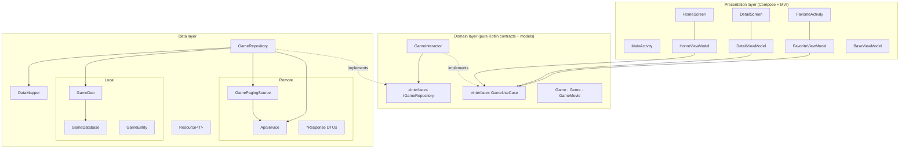
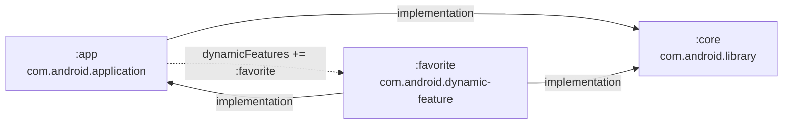
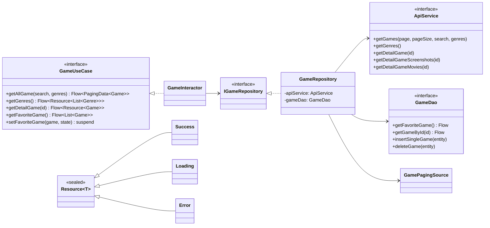
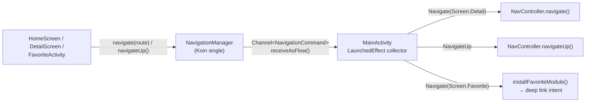

# 2. Architecture

## 2.1 Style

The project combines three patterns:

1. **Clean Architecture**: code is split into *Presentation → Domain → Data* layers. The domain layer defines the interfaces (`GameUseCase`, `IGameRepository`) and the data layer implements them.
2. **MVI (Model–View–Intent)**: each screen has an immutable `State`, a sealed `Intent`, and a ViewModel that reduces intents into new state (see [04-presentation-mvi.md](04-presentation-mvi.md)).
3. **Multi-module with a Dynamic Feature**: shared code lives in `:core`. The main screens are in `:app`, and Favorites is in the separately deliverable `:favorite` module.

## 2.2 Layer diagram



> **Note on purity:** `IGameRepository` and `GameUseCase` return `Flow<PagingData<Game>>` and `Resource<T>`. `Resource` lives in `core.data`, and `PagingData` is an AndroidX type. So the domain layer depends a little on the data layer and on Paging. This is common in Dicoding projects, but it isn't strictly clean.

## 2.3 Module dependency graph



- `:core` exposes nearly all third-party libraries with `api(...)`: Room, Retrofit, OkHttp, Koin, Navigation, Paging, Coil, Lottie, Compose, and SQLCipher. Consumers get them transitively.
- `:favorite` depends on `:app`, which is the standard setup for dynamic features. That is how it can use the app theme `Theme.SubmissionAndroidDeveloperExpert` and the base split.
- `:app` never references `:favorite` classes directly. It opens Favorites only through an implicit **deep-link intent**, which keeps the feature decoupled.

## 2.4 Package structure

```
:core  (com.raychal.core)
├── data
│   ├── GameRepository.kt            ← IGameRepository implementation
│   ├── Resource.kt                  ← Loading / Success / Error wrapper
│   └── source
│       ├── local
│       │   ├── entity/GameEntity.kt
│       │   └── room/GameDao.kt, GameDatabase.kt
│       └── remote
│           ├── network/ApiService.kt
│           ├── paging/GamePagingSource.kt
│           └── response/*.kt        ← Gson DTOs
├── di/CoreModule.kt                 ← databaseModule, networkModule, repositoryModule, useCaseModule, navigationModule
├── domain
│   ├── model/Game.kt, Genre.kt, GameMovie.kt
│   ├── repository/IGameRepository.kt
│   └── usecase/GameUseCase.kt, GameInteractor.kt
├── navigation/Screen.kt, NavigationCommand.kt, NavigationManager.kt
├── ui
│   ├── base/BaseViewModel.kt, UiState.kt, UiIntent.kt
│   ├── components/ (GameItem, Chips/FilterChips, LoadingCard, LottieAnimation,
│   │                LineScaleProgressIndicator, Label, StarRatingBar, Extensions(shimmer), CommonUi)
│   └── theme/Color.kt, Theme.kt, Type.kt
└── utils
    ├── Converters.kt                ← Room TypeConverters (Gson)
    ├── DataMapper.kt                ← Response ↔ Domain ↔ Entity
    ├── Ekstention.kt                ← formatGameDate()
    └── network/NetworkObserver.kt   ← ConnectivityObserver

:app  (com.raychal.submissionandroiddeveloperexpert)
├── MyApplication.kt                 ← loads sqlcipher, starts Koin
├── MainActivity.kt                  ← Scaffold + NavHost + NavigationManager collector + split install
├── di/AppModule.kt                  ← viewModelModule
└── ui
    ├── home/HomeContract.kt, HomeScreen.kt, HomeViewModel.kt
    └── detail/DetailContract.kt, DetailScreen.kt, DetailViewModel.kt, PlayerUi.kt

:favorite  (com.raychal.favorite)
└── ui/FavoriteActivity.kt (+ FavoriteScreen), FavoriteContract.kt, FavoriteViewModel.kt, FavoriteModule.kt
```

## 2.5 Class diagram (core contracts)



## 2.6 Cross-cutting: NavigationManager (event bus for navigation)

Composables and the `:favorite` module never hold a `NavController`. Instead they call the singleton `NavigationManager`, which pushes `NavigationCommand`s into a buffered `Channel`. `MainActivity` collects that channel and applies each command to the `NavController`. It also turns a `Screen.Favorite` command into a dynamic-module install and launch.


