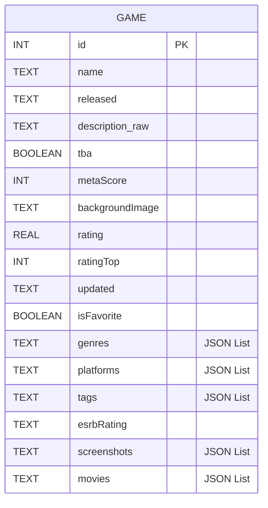
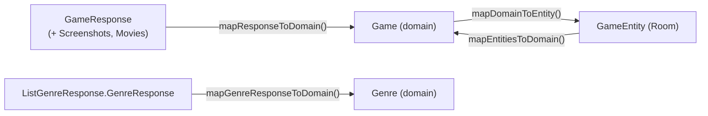
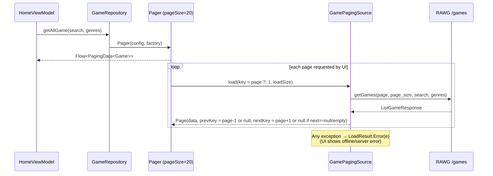
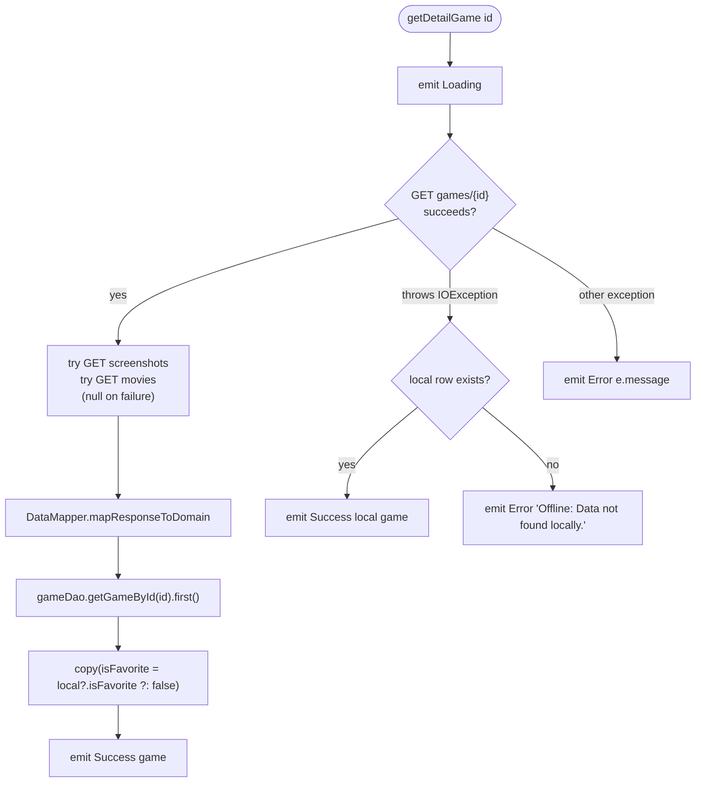

# 3. Data Layer

## 3.1 Remote: RAWG API (Retrofit)

The base URL and API key are read from `local.properties` (`BASE_URL`, `API_KEY`) into `BuildConfig` in `core/build.gradle.kts`. An OkHttp interceptor adds `?key=<API_KEY>` to every request.

| Method | Endpoint | Params | Returns | Used by |
|---|---|---|---|---|
| `getGames` | `GET games` | `page`, `page_size`, `search`, `genres` | `ListGameResponse` (`count`, `next`, `results`) | `GamePagingSource` |
| `getGenres` | `GET genres` | – | `ListGenreResponse` | `getGenres()` |
| `getDetailGame` | `GET games/{id}` | id | `GameResponse` | `getDetailGame()` |
| `getDetailGameScreenshots` | `GET games/{id}/screenshots` | id | `ScreenshotsGameResponse` | `getDetailGame()` (optional; failures are swallowed) |
| `getDetailGameMovies` | `GET games/{id}/movies` | id | `MoviesGameResponse` | `getDetailGame()` (optional; failures are swallowed) |

OkHttp client settings (`networkModule`):

- `HttpLoggingInterceptor` at level `BODY`
- An API-key query interceptor
- 120 s connect and read timeouts
- `CertificatePinner` for `api.rawg.io` with two SHA-256 pins

## 3.2 Local: Room + SQLCipher

- Database: `Game.db`, **version 6**, `exportSchema = false`, `fallbackToDestructiveMigration(false)`
- Encryption: `SupportOpenHelperFactory("rawg".toByteArray())` from `net.zetetic:sqlcipher-android`. The native library is loaded in `MyApplication.onCreate()` with `System.loadLibrary("sqlcipher")`.
- Type converters (`Converters`, Gson): `List<String>` ↔ JSON string and `List<GameMovie>` ↔ JSON string



**What gets stored:** only favorited games. `setFavoriteGame(game, true)` inserts the row with REPLACE. `setFavoriteGame(game, false)` **deletes** the row. The list feed is never cached locally because paging reads straight from the network.

DAO methods: `getAllGame`, `searchGames`, `getFavoriteGame`, `getGameById`, `insertGame`, `insertSingleGame`, `updateFavoriteGame`, `deleteGame`. Of these, only `getFavoriteGame`, `getGameById`, `insertSingleGame`, and `deleteGame` are actually used.

## 3.3 Models and mapping



Notable mapping rules (`DataMapper.mapResponseToDomain`):

| Domain field | Source |
|---|---|
| `genres` | `response.genres[].name` |
| `platforms` | `response.parent_platforms[].platform.name` |
| `tags` | `response.tags[].name` |
| `esrbRating` | `response.esrb_rating?.name` |
| `metaScore` | `response.metacritic` |
| `screenshots` | `/screenshots` → `results[].image` (empty if that call failed) |
| `movies` | `/movies` → `GameMovie(name, preview, url = data.max)` |
| `isFavorite` | Always `false` from the API. The repository then merges in the local value |

## 3.4 Repository operations

### `getAllGame(search, genres)`: Paging 3



### `getDetailGame(id)`: network first, local fallback



Everything runs on `Dispatchers.IO` through `flowOn`.

### `getGenres()`

`Loading`, then `Success(List<Genre>)` or `Error(message)`. Runs on `Dispatchers.IO`.

### `getFavoriteGame()` / `setFavoriteGame()`

- `getFavoriteGame()` returns `gameDao.getFavoriteGame()` (a Room `Flow`, so it updates automatically) mapped to domain models.
- `setFavoriteGame(game, state)`: on `Dispatchers.IO`, inserts when `state` is true and deletes when it is false.

## 3.5 Resource wrapper

```kotlin
sealed class Resource<T>(val data: T? = null, val message: String? = null) {
    class Success<T>(data: T) : Resource<T>(data)
    class Loading<T>(data: T? = null) : Resource<T>(data)
    class Error<T>(message: String, data: T? = null) : Resource<T>(data, message)
}
```

## 3.6 Network status observer

`ConnectivityObserver` wraps `ConnectivityManager.registerDefaultNetworkCallback` in a `callbackFlow`. It emits an initial status (from `NET_CAPABILITY_INTERNET`), then `Available / Losing / Lost / Unavailable`, with `distinctUntilChanged()`. `BaseViewModel` turns this into a `StateFlow` (`WhileSubscribed(5000)`, initial value `Unavailable`). The Detail screen uses it to decide whether to play the trailer or show the static preview.
