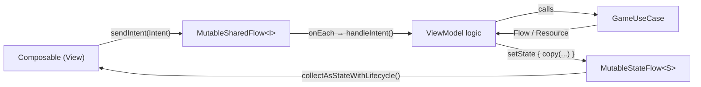
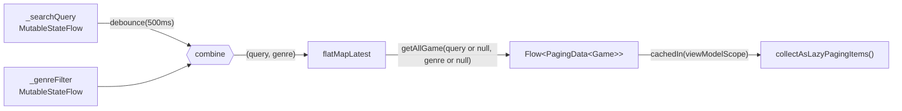
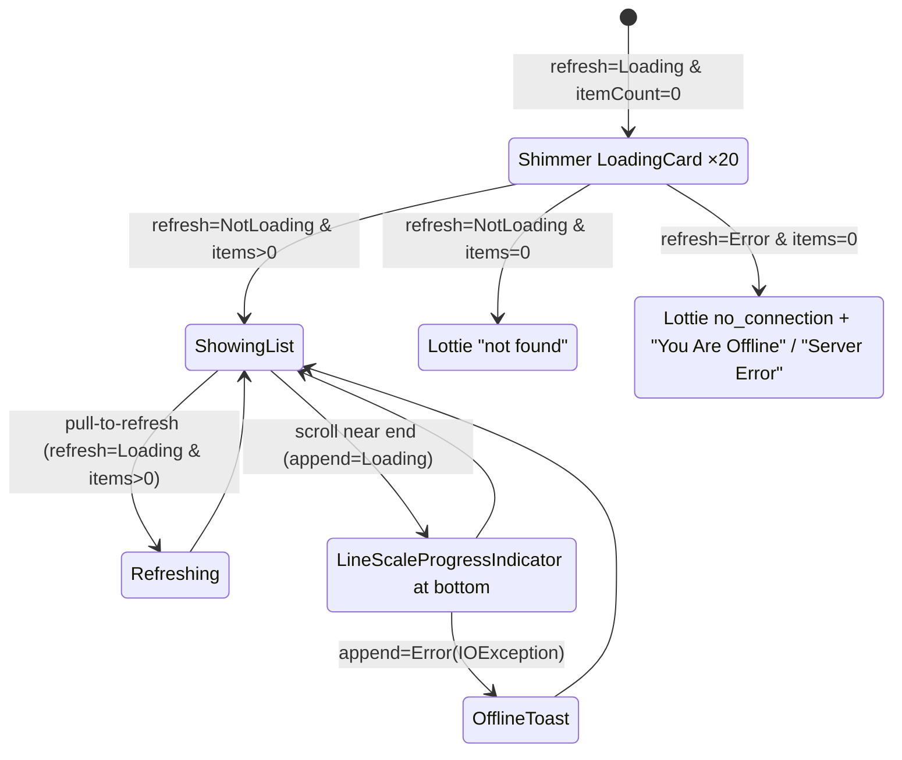
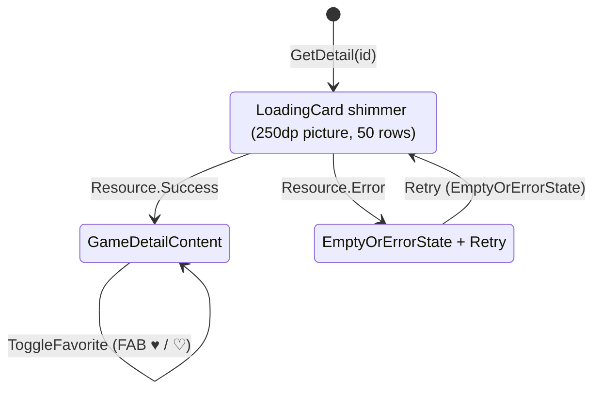
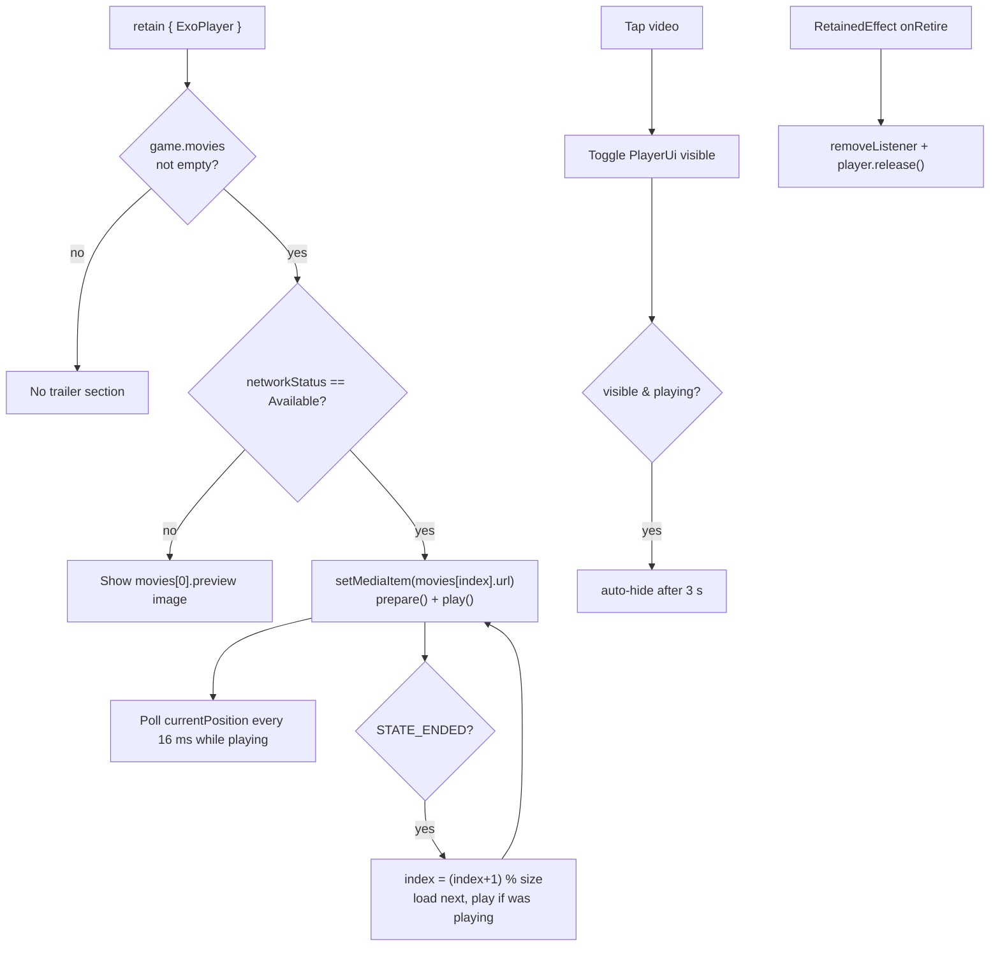

# 4. Presentation Layer (MVI + Compose)

## 4.1 MVI base

```kotlin
abstract class BaseViewModel<S : UiState, I : UiIntent>(initialState: S, networkObserver: NetworkObserver) : ViewModel() {
    val state: StateFlow<S>                      // single source of truth for the UI
    val networkStatus: StateFlow<NetworkObserver.Status>
    fun sendIntent(intent: I)                    // UI → VM (emits into MutableSharedFlow)
    protected abstract fun handleIntent(intent: I)
    protected fun setState(reducer: S.() -> S)   // atomic MutableStateFlow.update
}
```



The cycle runs in one direction only: the UI sends **intents** and renders **state**, and it never changes state itself.

## 4.2 Home

**Contract** (`HomeContract.kt`)

| State field | Type | Meaning |
|---|---|---|
| `pagingData` | `Flow<PagingData<Game>>` | Declared but unused. The UI collects `viewModel.gamesPagingData` instead |
| `search` | `String` | Current query |
| `genres` | `List<Genre>` | Chips to show |
| `selectedGenre` | `String` | Selected genre id (as a string) |

| Intent | Effect |
|---|---|
| `SearchGames(query)` | `_searchQuery.value = query` and update state |
| `SelectGenre(genreSlug)` | `_genreFilter.value = slug` and update state |
| `GetGenres` | Collect `getGenres()` and store the list on `Success`. Called from `init` |
| `Refresh()` | Reset search and genre to `""` |

**Reactive paging pipeline**



**UI states derived from `LazyPagingItems.loadState`**



The search `TextField` lives in `MainActivity`'s `TopAppBar`, not in `HomeScreen`. That's why `MainActivity` creates `homeViewModel` with `koinViewModel()` and passes the same instance to `HomeScreen`.

## 4.3 Detail

**Contract** (`DetailContract.kt`)

| State | Intent |
|---|---|
| `isLoading: Boolean` | `GetDetail(id)`: collect `getDetailGame(id)` and map `Resource` to state |
| `game: Game?` | `ToggleFavorite(game)`: `setFavoriteGame(game, !isFavorite)`, then `copy(game = game.copy(isFavorite = new))` |
| `errorMessage: String?` | |



**Trailer player logic** (inside `GameDetailContent`)



Other Detail details:

- **Back handling**: a custom `OnBackPressedCallback` and the top-bar back icon both call `navigationManager.navigateUp()`.
- **Favorite FAB** is visible only while the vertical scroll is idle (`derivedStateOf { !isScrollInProgress }`).
- **Metascore colors**: 0–50 red, 51–74 yellow (`#F0C04F`), 75+ green (`#6DC849`).
- **Rating badge**: shown when `ratingTop` is 4 or 5. A 5 shows the `exceptional` drawable, and other values show `recommended`.
- **Platform mapping**: RAWG parent platform names map to drawables (pc, play_station, xbox, nintendo, linux, mac, ios, android, browser), de-duplicated, max 3 plus "+N".

## 4.4 Favorite (dynamic feature)

| State | Intent |
|---|---|
| `isLoading: Boolean` (never set to `true`) | `GetFavorites`: collect `getFavoriteGame()` and set `favorites` |
| `favorites: List<Game>` | |

- `FavoriteActivity.attachBaseContext` calls `SplitCompat.installActivity(this)` so it can access the split's code and resources.
- `onCreate` calls `loadKoinModules(favoriteModule)`, which registers `FavoriteViewModel` as a `factory`.
- Tapping an item calls `navigationManager.navigate(Screen.Detail(id))` and then `finish()`. `MainActivity`, which is back in the foreground, receives the command and opens Detail.

## 4.5 Shared UI components (`core/ui/components`)

| Component | Purpose |
|---|---|
| `GameItem` | Card with image, name, and meta info. Used in the Home grid and the Favorite list |
| `FilterChips` / `Chips` / `ChipText` | Genre filter row |
| `LoadingCard` + `Modifier.shimmerEffect` | Shimmer skeleton placeholders |
| `LineScaleProgressIndicator` | Custom animated loader |
| `LottieNotFoundAnimation` | Lottie empty/error illustration (`search_file.json`, `no_connection.json`) |
| `EmptyOrErrorState` | Error message with a retry button |
| `Label` | Pill chip for genres and tags |
| `StarRatingBar` | Star display for `rating` |
| `Height(n)` / `Width(n)` | Spacer helpers |

The theme is dark (`Background #151515`, `BackgroundCard #202020`, `StarGold #FFD700`), with edge-to-edge drawing and a light status bar style.
