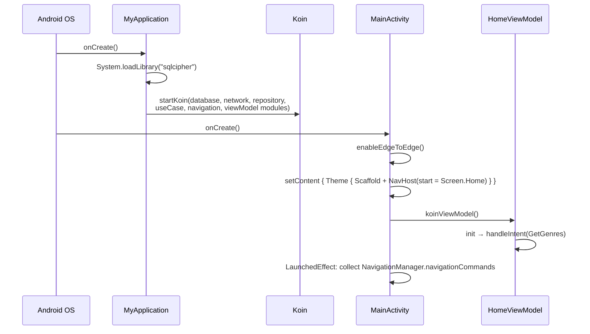
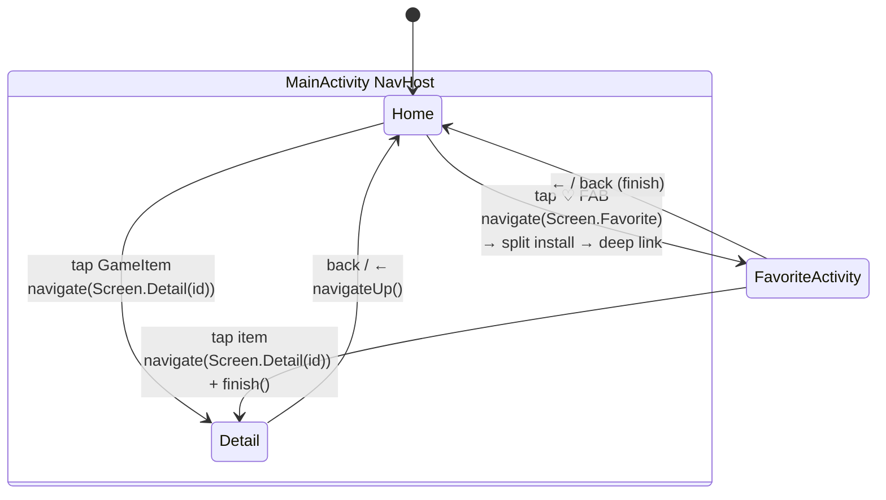
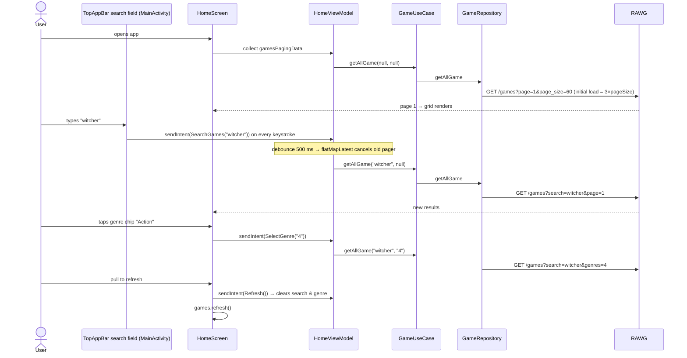
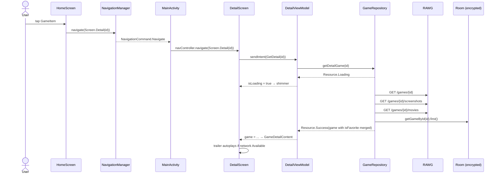
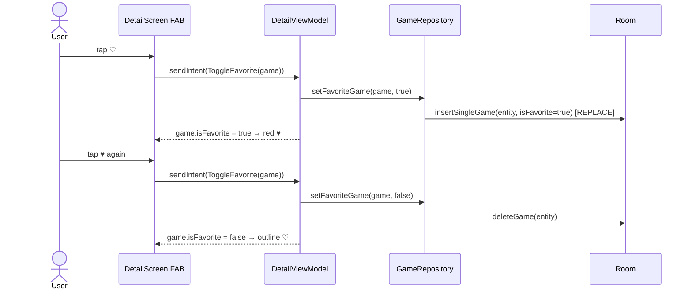
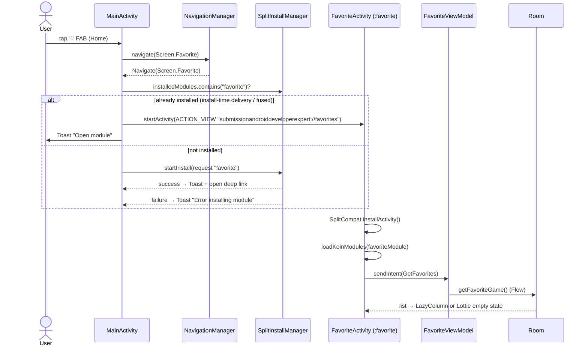
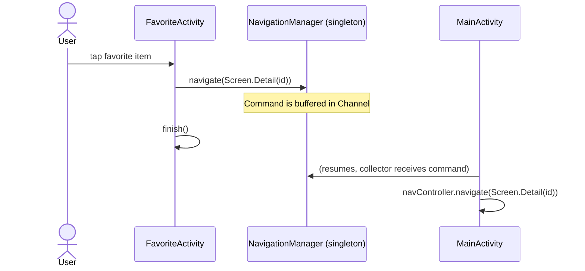

# 5. User Flows

## 5.1 App startup

## 5.2 Navigation map

Routes are type-safe `@Serializable` objects in `core.navigation.Screen`: `Home`, `Detail(gameId: Int)`, and `Favorite`. `Favorite` isn't registered in the `NavHost`. It is handled as a special case.

## 5.3 Browse, search, and filter games

> Pull-to-refresh clears the ViewModel's search query, but the `searchQuery` text in `MainActivity` is separate `remember` state. So the text field keeps showing the old text (see [findings](09-findings-and-recommendations.md)).

## 5.4 Open game detail

## 5.5 Toggle favorite

## 5.6 Open Favorites (dynamic feature delivery)

The `favorite` module is configured with `<dist:install-time/>` and `<dist:fusing dist:include="true"/>`. In practice it ships with the base install, so the "already installed" branch is the one that normally runs.

## 5.7 Favorite → Detail (cross-activity navigation)

## 5.8 Offline behaviour summary

| Situation | Result |
|---|---|
| Home first load offline | Lottie `no_connection` + "You Are Offline" |
| Home scrolling offline (append fails) | Toast "You Are Offline". Already loaded items stay |
| Server error on Home | Lottie + "Server Error" |
| Detail offline, game **is** favorited | Shown from the local DB (screenshots and movie URLs included, but images and video need network) |
| Detail offline, game not favorited | Error "Offline: Data not found locally." + Retry |
| Trailer offline | Static preview image instead of ExoPlayer |
| Favorites offline | Works fully (local DB). Images depend on Coil's cache |
