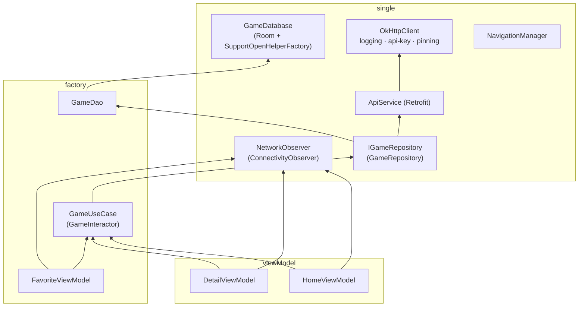

# 6. Dependency Injection (Koin)

## 6.1 Modules

| Koin module | File | Definitions |
|---|---|---|
| `databaseModule` | `core/di/CoreModule.kt` | `single` GameDatabase (Room + SQLCipher factory), `factory` GameDao |
| `networkModule` | `core/di/CoreModule.kt` | `single<NetworkObserver>` ConnectivityObserver, `single` OkHttpClient, `single` ApiService (Retrofit) |
| `repositoryModule` | `core/di/CoreModule.kt` | `single<IGameRepository>` GameRepository |
| `useCaseModule` | `core/di/CoreModule.kt` | `factory<GameUseCase>` GameInteractor |
| `navigationModule` | `core/di/CoreModule.kt` | `single` NavigationManager |
| `viewModelModule` | `app/di/AppModule.kt` | `viewModelOf(::HomeViewModel)`, `viewModelOf(::DetailViewModel)` |
| `favoriteModule` | `favorite/ui/FavoriteModule.kt` | `factory` FavoriteViewModel. Loaded lazily with `loadKoinModules` in `FavoriteActivity.onCreate` |

The first six are started in `MyApplication.onCreate()` with `startKoin { androidContext(...) }`.

## 6.2 Object graph

## 6.3 Injection sites

| Consumer | How |
|---|---|
| `MainActivity` | `private val navigationManager: NavigationManager by inject()`; `koinViewModel<HomeViewModel>()` |
| `HomeScreen` | `viewModel = koinViewModel()`, `navigationManager = koinInject()` (both default params) |
| `DetailScreen` | `viewModel = koinViewModel()`, `navigationManager = koinInject()` |
| `FavoriteActivity` | `koinInject<NavigationManager>()` |
| `FavoriteScreen` | `viewModel = koinViewModel()` |

> `FavoriteViewModel` is registered as a plain `factory`, not with `viewModel`/`viewModelOf`. `koinViewModel()` can still resolve it, but registering it with `viewModelOf(::FavoriteViewModel)` would match the other ViewModels. Also, calling `loadKoinModules` on every `onCreate` (for example, after a rotation) re-registers the module. Koin tolerates this, but it's worth knowing.
