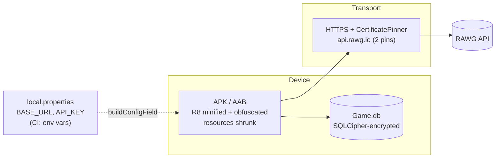

# 7. Security

The Android Developer Expert criteria require several security measures. Here is how the project covers them.

## 7.1 Database encryption

- **What:** Room opens the database through `net.zetetic.database.sqlcipher.SupportOpenHelperFactory`.
- **Where:** `core/di/CoreModule.kt` → `databaseModule`
- **Passphrase:** `"rawg".toByteArray()`, **hard-coded**. This meets the submission requirement, but anyone who decompiles the APK can read the key. For production, derive or store the key with the Android Keystore (for example, a random key wrapped by a Keystore AES key, or `EncryptedSharedPreferences`).

## 7.2 Certificate pinning

- `OkHttpClient.certificatePinner` pins `api.rawg.io` to two SHA-256 SPKI hashes (a primary and a backup or intermediate).
- **Risk:** if RAWG rotates its certificates and neither pin matches, every request fails. Keep the pins up to date. Consider adding a Network Security Config with an expiration date as an extra safeguard.

## 7.3 Code obfuscation (R8)

- `:app`: `isMinifyEnabled = true` and `isShrinkResources = true` for **both `debug` and `release`**
- `:core` and `:favorite`: `isMinifyEnabled = false` (library and feature code is processed by the app's R8 pass)
- `app/proguard-rules.pro` keeps:
  - Navigation routes (`com.raychal.core.navigation.**`) and domain models (needed for kotlinx-serialization and Gson `TypeToken<List<GameMovie>>`)
  - Gson `@SerializedName` fields, Retrofit interfaces, Koin, ViewModel constructors, Room DB/entities, Media3, Paging, Coil
  - SQLCipher (`net.zetetic.database.**`, `net.sqlcipher.**`)
  - `com.raychal.favorite.ui.**` and `SplitCompat`, which the dynamic feature needs because the base R8 pass can't see feature code
- One rule targets `com.raychal.core.data.remote.response.**`, but the real package is `com.raychal.core.data.source.remote.response`. The DTOs are still protected by the generic `@SerializedName` keep rule.

## 7.4 Secrets management

- `BASE_URL` and `API_KEY` are read from `local.properties`. That file is listed in `.gitignore` and isn't tracked by git ✔. In CI, CircleCI writes it from project environment variables.
- The key ends up in `BuildConfig`, which R8 *obfuscates* but does not *hide*. Never treat any client-side API key as secret.

## 7.5 Other observations

| Item | Status |
|---|---|
| `HttpLoggingInterceptor.Level.BODY` | Enabled in **all** builds. Release logcat would show full responses and the request URL, including `key=` |
| `android:allowBackup="true"` | Backups follow `backup_rules.xml` / `data_extraction_rules.xml`. The DB is encrypted anyway |
| `FavoriteActivity android:exported="true"` | Needed for the implicit deep link. It only reads local data, so the risk is low |
| LeakCanary | `debugImplementation` only ✔ |
| Permissions | `INTERNET`, `ACCESS_NETWORK_STATE` only ✔ |
