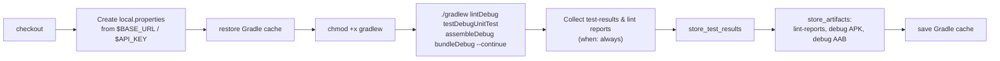
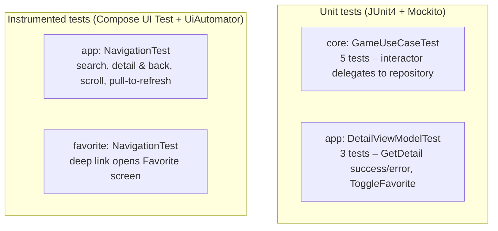

# 8. Build, CI, and Testing

## 8.1 Gradle setup

- **Gradle version catalog:** `gradle/libs.versions.toml` (versions, libraries, plugins, and a `media3` bundle)
- **Root plugins:** android-application, android-library, android-dynamic-feature, kotlin-compose, kotlin-serialization, ksp (all `apply false`)
- **SDK:** `compileSdk = release(36) { minorApiLevel = 1 }`, `minSdk 24`, `targetSdk 36`, Java 17
- **`gradle.properties`:** configuration cache, build cache, parallel builds, 4 workers, parallel tooling sync, `nonTransitiveRClass`
- **Lint:** `abortOnError = false`, baseline `app/lint_baseline.xml`, text report

| Module | Plugin | Notable config |
|---|---|---|
| `:app` | `com.android.application` | `dynamicFeatures += ":favorite"`, R8 on in debug and release |
| `:core` | `com.android.library` | `buildConfig = true` (BASE_URL, API_KEY), KSP Room compiler, most libraries exposed as `api` |
| `:favorite` | `com.android.dynamic-feature` | Depends on `:app` + `:core`, Play Feature Delivery |

### Required local setup

Create or extend `local.properties` in the project root:

```properties
sdk.dir=/path/to/Android/sdk
BASE_URL=https://api.rawg.io/api/
API_KEY=<your RAWG key from https://rawg.io/apidocs>
```

> `core/build.gradle.kts` loads `local.properties` with no fallback. If the file is missing, configuration fails. If a key is missing, the string `"null"` is written into BuildConfig.

### Common commands

```bash
./gradlew assembleDebug          # APK (minified)
./gradlew bundleRelease          # AAB with :favorite split
./gradlew testDebugUnitTest      # JVM unit tests
./gradlew connectedDebugAndroidTest   # instrumented UI tests (device needed, real network)
./gradlew lintDebug
```

## 8.2 CI pipeline (CircleCI)

`.circleci/config.yml`: a single job, `build_and_test`, running on the `cimg/android:2026.03.1` image with a `large` resource class.



Workflow `main` runs `build_and_test` on every push. The README shows the CircleCI badge for branch `final/capstone`.

> Recent history: the Kover coverage plugin was added and later removed (`52abd44`). Debug minification was enabled in `4dfdb9e`.

## 8.3 Tests



| Test class | Module | Cases |
|---|---|---|
| `GameUseCaseTest` | core | `getDetailGame` Success / Error; `getFavoriteGame` list / empty; `setFavoriteGame` delegates |
| `DetailViewModelTest` | app | `GetDetail` → Success state; `GetDetail` → Error state; `ToggleFavorite` flips `isFavorite` |
| `NavigationTest` | app | `testSearchFunctionality`, `testNavigateToDetailAndBack`, `testScrollHomeScreen`, `testPullToRefresh` |
| `NavigationTest` | favorite | `testNavigateToFavorite` (deep link) |

Instrumented tests call the **real RAWG API** and wait up to 30–35 s for items, so they need network access and a valid key. They aren't run in CI.

Test tags used by the UI tests include `GameItem`, `GameList`, `PullToRefreshBox`, `PullToRefreshIndicator`, `DetailContent`, `DetailScaffold`, `FavoriteList`, `ErrorAnimation`, and `EmptyAnimation`.

### Coverage gaps

- `GameRepository` (network/local fallback logic) has no tests
- `GamePagingSource` key calculation has no tests
- `HomeViewModel` (debounce, `flatMapLatest`, refresh) and `FavoriteViewModel` have no tests
- `DataMapper` and `Converters` have no tests
