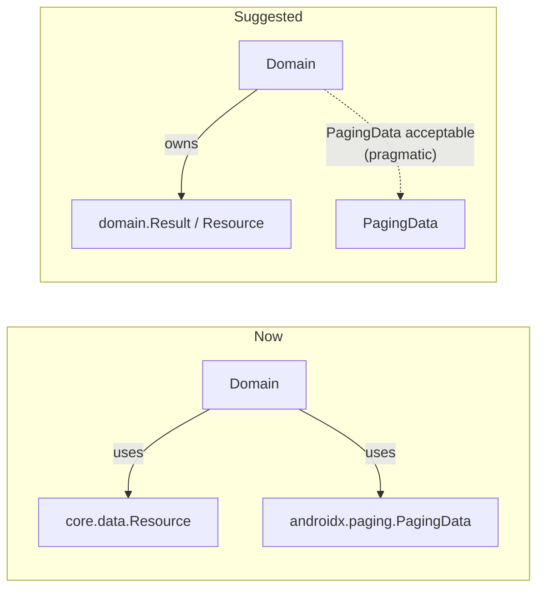

# 9. Findings and Recommendations

These come from a static read of the code. Nothing here was run on a device. The severity labels are a rough guide.

## 9.1 Behavioural issues

| # | Severity | Where | Finding | Suggestion |
|---|---|---|---|---|
| 1 | Medium | `MainActivity` / `HomeViewModel.Refresh` | Pull-to-refresh clears the ViewModel's search query, but the `searchQuery` text shown in the top bar is separate `remember` state in `MainActivity`. The field keeps the old text while the list shows unfiltered results | Drive the text field from `homeViewModel.state.search` instead of local state |
| 2 | Medium | `HomeScreen` `onRefresh` | Calls `sendIntent(Refresh())` **and** `games.refresh()`. If search or genre was set, changing them already creates a new pager through `flatMapLatest`, so the explicit refresh hits the old pager and causes a wasted request | Do only one of the two: refresh when filters are already empty, otherwise just reset the filters |
| 3 | Low | `DetailViewModel.getDetail` | Each `GetDetail` (including **Retry**) starts a new `launchIn` collection without cancelling the previous one | Keep a `Job` and cancel it before starting a new one |
| 4 | Low | `FavoriteViewModel` | `isLoading` is never set to `true`, so the loader never shows. Each `GetFavorites` also adds another Room collector | Set loading first, keep one job, or expose `stateIn` directly |
| 5 | Low | `DetailViewModel.toggleFavorite` | UI state flips only after the DB write and doesn't handle failures | Fine for this scale. Optionally update optimistically and roll back on error |
| 6 | Low | `GameDetailContent` player listener | `goToNextVideo()` captures `game` and `currentVideoIndex` from the first composition inside `RetainedEffect(player)`. If `game` changes while the player is retained, it could use stale movies | Key the effect on `game.movies` too, or read the values through `rememberUpdatedState` |
| 7 | Low | `InfiniteHorizontalCarousel` | Uses 1000 virtual pages and auto-scrolls forever. After about 50 minutes it reaches the end | Wrap the index, or use `Int.MAX_VALUE / 2` as the start |
| 8 | Low | `PlayerUi` track | `sliderState.value / duration` divides by 0 before `STATE_READY`, which gives NaN | Guard with `if (duration > 0)` |
| 9 | Info | `HomeState.pagingData` | Unused field (holding a `Flow` in state isn't idiomatic anyway) | Remove it |
| 10 | Info | `HomeIntent.Refresh` is a `class` and `GetGenres` is an `object` | Inconsistent | Make both `data object` |
| 11 | Info | `MainActivity` | `@RequiresApi(S)` on `onCreate` while `minSdk = 24`. Several composables are marked `@RequiresApi(O)` only because of `java.time` | Enable core library desugaring, or use a version-safe formatter, and drop the annotations |
| 12 | Info | `GameDao` | `getAllGame`, `searchGames`, `insertGame`, and `updateFavoriteGame` are unused | Remove them, or use them for list caching (see 9.3) |

## 9.2 Security and configuration

| # | Finding | Suggestion |
|---|---|---|
| S1 | Hard-coded SQLCipher passphrase `"rawg"` | Generate a random key and protect it with the Android Keystore |
| S2 | `HttpLoggingInterceptor.Level.BODY` in release, which logs the API key in URLs | `if (BuildConfig.DEBUG) BODY else NONE`. Also add `redactQueryParams("key")` (OkHttp 5) |
| S3 | Wrong package in a ProGuard rule (`core.data.remote.response`) | Change it to `com.raychal.core.data.source.remote.response.**` |
| S4 | Debug build minified | Slows down local builds and debugging. Use it only if you need to test R8 behaviour |
| S5 | 120 s timeouts | 15–30 s is more typical for a mobile UI |
| S6 | `fallbackToDestructiveMigration(false)` with `exportSchema = false` at DB v6 | Export schemas and write migrations so users don't lose favorites on upgrade |
| S7 | `local.properties` is required, with no defaults | Use `properties.getProperty("API_KEY", "")` and/or Gradle properties or env vars |

## 9.3 Architecture improvements

1. **Domain purity:** move `Resource` into `core.domain` (or a `common` module) so the domain doesn't import from the data layer.
2. **Offline list caching:** use `RemoteMediator` with Room (`room-paging` is already a dependency) so the Home feed works offline. This would also put the unused DAO queries to use.
3. **Separate favorites table:** today the `game` table is effectively "favorites only", and removing a favorite deletes the row. Caching would need either an `isFavorite` flag with update (not delete) or a separate table.
4. **Use-case granularity:** `GameInteractor` only forwards calls to the repository. Single-purpose use cases (`GetGamesUseCase`, `ToggleFavoriteUseCase`) would be more idiomatic, though the current setup is fine for the submission.
5. **Navigation:** `NavigationManager` with a buffered `Channel` works, but a command sent while `MainActivity` is in the background waits in the buffer. That is the intended Favorite → Detail behaviour, but it's implicit. Document it or use explicit result APIs.
6. **Tests:** add unit tests for `GameRepository` (fake `ApiService` and in-memory DAO), `GamePagingSource` (`TestPager`), `HomeViewModel` (Turbine plus a test dispatcher for the debounce), and `DataMapper`.

## 9.4 Strengths

- Clean module separation, with the dynamic feature reached only through a deep link (no compile-time coupling)
- A consistent MVI base (`BaseViewModel`) across all three screens
- Type-safe Compose Navigation routes
- A well-built Detail screen: retained ExoPlayer with lifecycle cleanup, network-aware playback, auto-hiding controls, and a carousel
- Several security layers (SQLCipher, pinning, R8) and a working CI pipeline
- Polished loading, empty, and error states (shimmer, Lottie, custom refresh indicator)
- Indonesian and English localization
