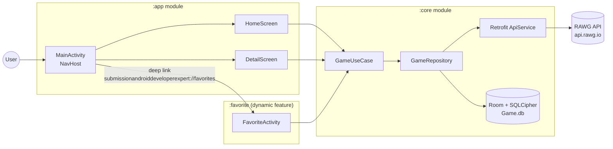

# Project Analysis: SubmissionAndroidDeveloperExpert ("STG")

This folder documents the whole project: what it does, how it is built, and how data and users move through it. Most pages include **Mermaid** diagrams, which render on GitHub, GitLab, in Android Studio (with the Markdown plugin), and in VS Code.

## Quick summary

| Item | Value |
|---|---|
| App name (launcher) | **STG** |
| Application ID | `com.raychal.submissionandroiddeveloperexpert` |
| Purpose | Browse, search, and filter video games from the **RAWG API**, view rich details (screenshots, trailers), and save favorites offline |
| Context | Dicoding *"Menjadi Android Developer Expert"* (Android Developer Expert) capstone submission |
| Language / UI | Kotlin 2.3 · Jetpack Compose · Material 3 |
| Architecture | Clean Architecture (Data / Domain / Presentation) + **MVI** + multi-module + **Dynamic Feature** |
| Modules | `:app`, `:core` (Android library), `:favorite` (dynamic feature) |
| DI | Koin 4.2 |
| Min / Target SDK | 24 / 36 |
| CI | CircleCI (lint, unit tests, assemble APK + AAB) |

## Table of contents

| # | Document | What it covers |
|---|---|---|
| 1 | [01-overview.md](01-overview.md) | Purpose, features, and tech stack |
| 2 | [02-architecture.md](02-architecture.md) | Clean Architecture layers, module graph, package tree |
| 3 | [03-data-layer.md](03-data-layer.md) | RAWG API, Room + SQLCipher, Paging 3, mappers, offline strategy |
| 4 | [04-presentation-mvi.md](04-presentation-mvi.md) | MVI base classes, each screen's State/Intent, state machines |
| 5 | [05-user-flows.md](05-user-flows.md) | Navigation and step-by-step sequence diagrams for each feature |
| 6 | [06-dependency-injection.md](06-dependency-injection.md) | Koin modules and the object graph |
| 7 | [07-security.md](07-security.md) | Certificate pinning, DB encryption, R8/ProGuard, secrets |
| 8 | [08-build-ci-testing.md](08-build-ci-testing.md) | Gradle setup, version catalog, CircleCI pipeline, tests |
| 9 | [09-findings-and-recommendations.md](09-findings-and-recommendations.md) | Bugs, risks, and suggested improvements |

## The big picture in one diagram

